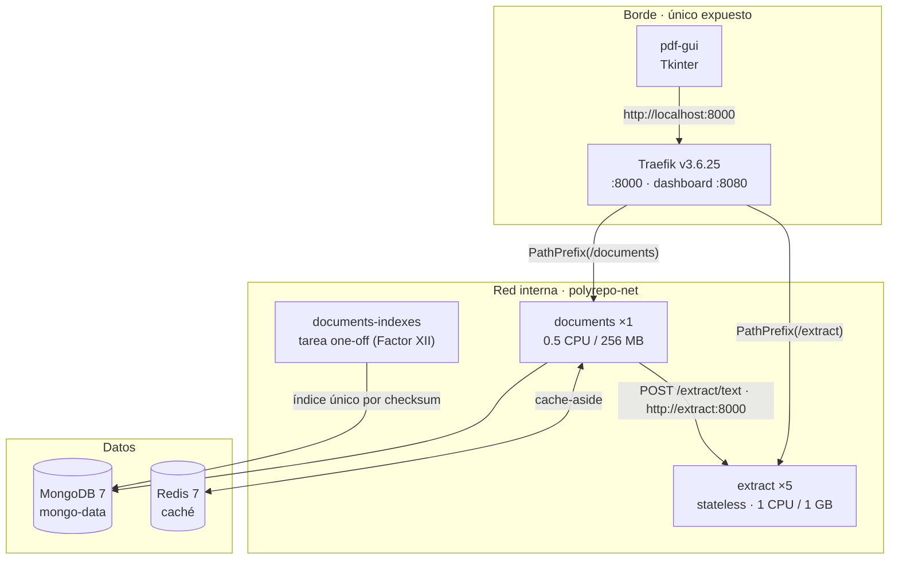

# PDF Extract Orchestrator


> **Este repositorio no contiene código de negocio:** contiene el *contrato de despliegue* del
> sistema. Define cómo se levantan, se conectan y se observan los microservicios del poly-repo
> **PDF Extract**, aplicando los principios **12-Factor App** y usando **Traefik** como API Gateway.

---

📂 Estructura del Repositorio
pdf-extract-orchestrator/
├── docker-compose.yml             # Definición completa de la topología, redes, volúmenes y Traefik
├── .env.example                   # Plantilla centralizada de variables de entorno (Factor III)
├── .gitignore                     # Exclusión de archivos sensibles (.env) y logs temporales
├── scripts/
│   ├── run-gui.ps1                # Script de lanzamiento de pdf-gui para Windows (PowerShell)
│   └── run-gui.sh                 # Script de lanzamiento de pdf-gui para Linux / macOS
├── .github/
│   └── workflows/
│       └── validate.yml           # Pipeline de CI: valida sintaxis de Docker Compose en cada push
└── README.md                      # Documentación arquitectónica y guía de operación


| Repositorio | Rol en la arquitectura | Imagen / ejecución | Exposición |
|---|---|---|---|
| **pdf-extract-orchestrator** | Infraestructura, rutas, red y arranque (este repo) | `docker compose` | Único punto de entrada: `:8000` |
| **pdf-extract-service** | Extrae texto/Markdown de PDFs con PyMuPDF; OCR opcional | `ghcr.io/lighuen04/pdf-extract-service` | Solo red interna, 5 réplicas |
| **pdf-documents-service** | Historial, deduplicación por SHA-256, saga y caché | `ghcr.io/lautirebeco/pdf-documents-service` | Solo red interna, 1 réplica |
| **pdf-gui** | Cliente de escritorio (Tkinter/CustomTkinter) | `uv run python interface.py` | Proceso local del usuario |

**Infraestructura adjunta:** MongoDB 7 (persistencia, volumen `mongo-data`) y Redis 7 (caché
cache-aside). Ninguno publica puertos al host: solo son alcanzables desde la red
`polyrepo-net`.

---

## 🗺️ Cómo se conectan



el cliente *nunca* habla con los microservicios. Habla con
Traefik, que rutea por prefijo de URL y balancea entre las réplicas. El servicio `documents`, en
cambio, llama a `extract` **por DNS interno de Docker** (`http://extract:8000`), sin volver a
pasar por el gateway. Eso evita publicar el servicio de extracción y evita el `404` que aparecía
cuando la comunicación se hacía de forma incorrecta (la corrección quedó registrada en el
historial de este repo).

### Flujo de un upload (SAGA)

1. La GUI calcula el **SHA-256** local del PDF y envía `POST /documents/upload` al gateway.
2. Traefik aplica los middlewares de **rate limit** y **tamaño máximo de body**, y enruta
   `/documents*` hacia `documents`.
3. `documents` **reserva** el registro en MongoDB con `estado="pendiente"` mediante un lock
   atómico. Si otro worker ya lo tiene, responde `409 + Retry-After`.
4. `documents` pide el texto a `extract` con `POST /extract/text`; el DNS de Docker reparte la
   llamada entre las 5 réplicas. Aquí viven el **circuit breaker**, el **bulkhead** y los
   **reintentos con backoff**.
5. Si la extracción termina bien, se guarda el texto y el documento pasa a `estado="ok"`,
   invalidando la caché de Redis. Si falla, la **compensación** marca `estado="error"`, libera el
   lock e invalida la caché; una tarea de recuperación revisa las sagas huérfanas al arrancar y
   periódicamente.
6. La GUI hace polling de `GET /documents/by-checksum/{sha256}` hasta `ok|error` y descarga el
   texto con `GET /documents/{id}/download`. Cada petición propaga `X-Request-ID` para correlacionar
   logs entre servicios.
7. El modo **Markdown** es la excepción deliberada: llama directo a `POST /extract` y no crea
   documento ni saga.

> El PDF original **no se persiste**. Por eso, ante una saga compensada, el cliente vuelve a subir
> los mismos bytes: el índice único por checksum garantiza que el reintento sea idempotente.

---

## ⚙️ Decisiones de implementación

| Decisión | Qué resuelve | Dónde está |
|---|---|---|
| `exposedByDefault=false` + ruteo por `PathPrefix` | Solo existen las rutas `/extract` y `/documents`; el resto queda cerrado | Labels de Traefik en `docker-compose.yml` |
| Rate limit (30 avg / 60 burst) y max body (11 MB) **en el borde** | Protección contra ráfagas y PDFs demasiado grandes antes de consumir CPU | Middlewares `edge-ratelimit` y `pdf-maxbody` |
| `extract` ×5, *stateless* y con `/health` | Escalado horizontal de la parte que consume CPU; se puede reemplazar una réplica sin perder estado | `deploy.replicas` + `healthcheck` |
| `documents` → `extract` por DNS interno | Comunicación directa, sin exponer `extract` ni depender del gateway | `EXTRACT_SERVICE_URL=http://extract:8000` |
| `documents-indexes` como contenedor puntual | Crea el índice único **antes** de aceptar tráfico, usando la misma imagen y configuración | `command: python -m app.admin.create_indexes` |
| `depends_on` con `condition:` | `documents` arranca solo cuando Mongo, Redis, `extract` y los índices están listos | Sección `depends_on` |
| Red bridge `polyrepo-net` + volumen nombrado | Aislamiento de servicios y persistencia de Mongo entre `down`/`up` | `networks` y `volumes` |

---

## 🚀 Cómo levantar el sistema

1. Copiar variables de entorno:
   ```bash
   cp .env.example .env
   ```
2. Iniciar los contenedores:
   ```bash
   docker compose up -d
   ```
3. Ejecutar la interfaz gráfica apuntando al gateway Traefik:
   - Windows: `.\scripts\run-gui.ps1`
   - Linux/macOS: `./scripts/run-gui.sh`

> **Resultado esperado:** gateway en `http://localhost:8000`, dashboard de Traefik en
> `http://localhost:8080` y la GUI abierta con `PDF_EXTRACT_GATEWAY_URL=http://localhost:8000`
> (la configuran los scripts de `scripts/`).

### Comprobación rápida (opcional)

```bash
curl -s -o /dev/null -w "%{http_code}\n" http://localhost:8000/documents  # debe devolver 200
docker compose ps                                                        # healthchecks y estados
```

---

## 🔧 Configuración

Toda la configuración se lee de `.env` (plantilla en `.env.example`); no hay secretos en el código.

| Grupo | Variables (valor por defecto) |
|---|---|
| Gateway | `GATEWAY_PORT=8000`, `TRAEFIK_DASHBOARD_PORT=8080` |
| Imágenes | `EXTRACT_IMAGE=...:latest`, `DOCUMENTS_IMAGE=...:latest` — fijar `sha-<commit>` o `vX.Y.Z` en producción |
| Escalado y límites | `EXTRACT_REPLICAS=5`, `MAX_PDF_SIZE_BYTES=10485760` (10 MB), `APP_OCR_ENABLED=false`, `APP_EXTRACT_WORKERS=1`, `APP_MAX_PENDING_EXTRACTIONS=100` |
| Datos | `MONGODB_DB_NAME=pdf-extractext`, `MONGO_COLLECTION_NAME=documents` |
| Resiliencia | `EXTRACT_TIMEOUT_S=30`, `EXTRACT_MAX_ATTEMPTS=2`, `DOCUMENTS_API_KEY=` (vacío en local) |
| Borde | `RATE_LIMIT_AVG=30`, `RATE_LIMIT_BURST=60` |

> Las URLs internas (`mongodb://mongodb:27017`, `redis://redis:6379/0` y
> `http://extract:8000`) están fijadas en el compose porque se resuelven por DNS de Docker.

---

## 📡 Rutas que expone el gateway

| Ruta | Destino | Protección aplicada |
|---|---|---|
| `/extract*` | `extract:8000` (balanceo entre 5 réplicas) | `edge-ratelimit`, `pdf-maxbody` |
| `/documents*` | `documents:8000` | `edge-ratelimit`, `pdf-maxbody` |
| `:8080` | Dashboard de Traefik | Modo insecure: **solo entorno local** |

---

## ✅ 12-Factor aplicado a la orquestación

| Factor | Cómo se cumple aquí |
|---|---|
| I. Codebase | Un repo por servicio; este repo versiona solo compose, `.env.example` y scripts. |
| II. Dependencias | Cada servicio fija las suyas en `pyproject.toml` + `uv.lock`; este repo no instala código. |
| III. Config | Toda la configuración por entorno; `cp .env.example .env` antes de arrancar. |
| IV. Backing services | MongoDB, Redis y `extract` son recursos adjuntos configurables por URL. |
| V. Build, release, run | Las imágenes se publican en GHCR; el compose elige qué tag/release corre. |
| VI. Procesos | Los 5 procesos de `extract` son *stateless*: el estado vive en MongoDB/Redis. |
| VII. Port binding | Traefik hace bind de `:8000`; los servicios solo escuchan en la red interna. |
| VIII. Concurrencia | Réplicas de `extract`, workers/cola acotados y bulkhead en `documents`. |
| IX. Disposabilidad | Healthchecks + `depends_on` por `service_healthy` / `service_completed_successfully`. |
| X. Dev/prod parity | Mismo `docker-compose.yml` con distinto `.env`; la CI valida el compose. |
| XI. Logs | Los servicios escriben JSON a stdout con `request_id` para correlacionar entre servicios. |
| XII. Admin processes | `documents-indexes` ejecuta la misma imagen como tarea única antes del tráfico. |

---

## 🧪 Validación del repositorio

El workflow `.github/workflows/validate.yml` copia `.env.example` a `.env` y ejecuta
`docker compose config --quiet` en cada push y PR a `main`.

> **Alcance:** este compose está preparado para desarrollo y demostración en local. En producción
> hay que desactivar el dashboard insecure, configurar `DOCUMENTS_API_KEY`, fijar imágenes por
> digest/tag inmutable y terminar TLS en el gateway.
